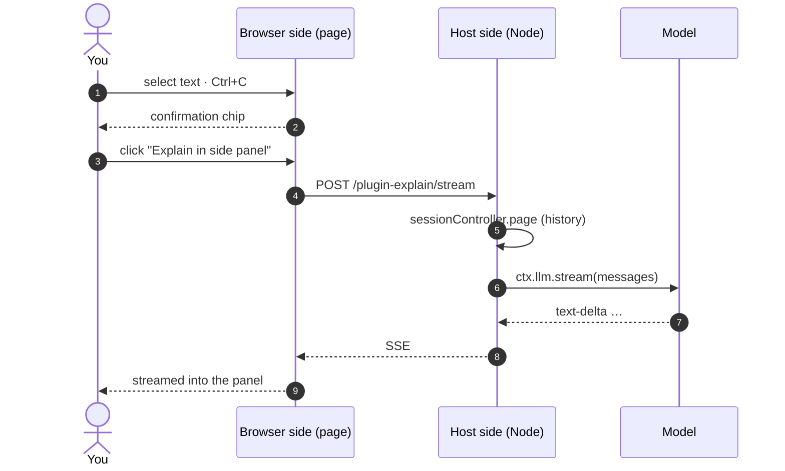

<div align="center">

# dsh-plugin-side-explain

**Ask about any passage, right where you're reading.**
Answers live in a side panel — never in the session log, never moving the transcript.

[](https://github.com/Echo-moli/dsh-plugin-side-explain/actions/workflows/check.yml)
[](LICENSE)


English · [中文](README.md)

</div>


<p align="center"><sub>Illustration, not a screenshot. Select on the left, read on the right, the transcript stays put.</sub></p>

## Why

In a long conversation, the only ways to ask about a passage are to copy it into the composer — which injects the question into the main transcript and dilutes context — or to give up. And after a long answer, getting back to your reading position means scrolling by hand.

This plugin moves the question out of the transcript: **ask from a side panel, read there, keep the conversation as read-only background.**

- **Nothing is written**: one model call, zero session-log entries. Close the panel and it is gone.
- **Nothing moves**: the panel scrolls on its own; scroll position, semantic anchors and the turn rail are untouched.
- **Context is still your conversation**: history is read from the same source the main composer uses, so “that plan above” resolves correctly.

## Quick start

```bash
dsh plugin --profile desktop add github:Echo-moli/dsh-plugin-side-explain
# restart DSH — the plugin list is read at startup only
```

Select ≥6 characters in the transcript, press `Ctrl+C`, then click **Explain in side panel**.

<details>
<summary>Manual install</summary>

Copy this repository to `$DSH_HOME/profiles/<profile>/node_modules/dsh-plugin-side-explain`, append to `cordis.patch.yml`:

```yaml
- insert:
    - id: ui-side-explain
      name: dsh-plugin-side-explain
```

Restart DSH and confirm the entry under **Settings → Plugins**.

</details>

## Features

| | Feature | Notes |
| --- | --- | --- |
| 📋 | Select to ask | ≥6 chars + `Ctrl+C`; your clipboard still works as usual |
| ✏️ | Add an instruction | Opens the panel with the caret in the input, so you can say “only the second point” |
| 📜 | Streaming Markdown | Headings, lists, bold, inline code, fenced code, quotes, links |
| 🔁 | Follow-ups | The button becomes **Ask**, continuing the same thread — still no session writes |
| ⏹️ | Cancellable | The button becomes **Stop** while streaming; the panel is kept |
| 🔍 | Empty-output diagnostics | Reports which chunks arrived when the model returns no text |
| 📦 | Zero dependencies | Only `ctx.webServer` and `ctx.llm` on the host side |

## How it works



`lib/client.js` runs in the page (DOM markers, panel, Markdown). `lib/index.js` runs in the Node host (route, history, model stream). One package, two runtimes: `main` → host, `exports["./client"]` → page.

## Context sources

| Source | Content | Cap |
| --- | --- | --- |
| Session log (preferred) | `sessionController.page` — same messages the composer sees | 200 msgs / 12k chars |
| DOM excerpt (fallback) | Up to 6 previous turns, windowed around the selection | 6k chars |
| Thread | Previous Q/A pairs in the panel | 6 rounds |

## Design constraints

Three rules that are not optimisations — without them the model returns nothing:

1. **The first message must be `user`.** Truncated history often begins with an assistant message; providers then return an empty completion (`finish×1`).
2. **Re-send the passage every round.** If only the first message carries it, follow-ups fail with “no text to explain”.
3. **The cursor is obtained from an error.** `page()` requires `throughSeq` and no public cursor getter exists, so an out-of-range call is made once and the cursor parsed from the error message.

## Limitations

- Depends on DOM markers (`data-chat-turn`, `data-conversation-scroll`, `data-conversation-session`); a DSH update may require changes.
- The endpoint listens on loopback only but has **no additional auth**; other local processes can call it.
- Text selections only — no images, attachments or tool cards.

## Troubleshooting

| Symptom | Check |
| --- | --- |
| Nothing happens on copy | Plugin loaded? Console for `selection-quote` |
| Panel opens, no text | The error reports chunk types; `finish×1` means an empty completion |
| No context in the answer | Use the probe endpoint below |
| “No model provider available” | `ctx.llm.listProviders()` is empty — configure a model first |

```bash
curl -s -X POST http://127.0.0.1:<port>/plugin-explain/stream \
  -H 'content-type: application/json' \
  -d '{"text":"probe","sessionId":"session-...","debug":true}'
```

## Development

No build step — `lib/*.js` are the artefacts.

```bash
npm run check   # node --check on both halves
```

Copy into the profile's `node_modules` and restart the window to try changes.

## License

[MIT](LICENSE) © Echo-moli
