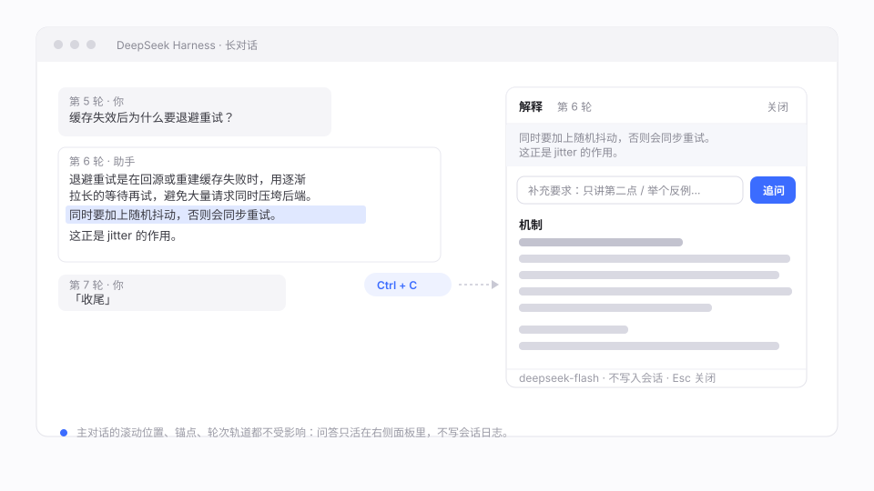
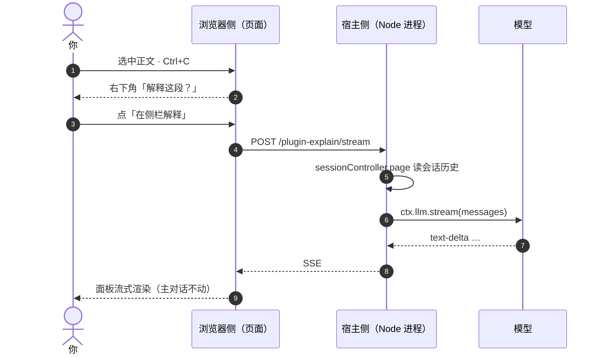

<div align="center">

# dsh-plugin-side-explain

**选中即问，答案在侧栏。**
不写会话历史，不动阅读位置——长对话里最缺的那个对话框。

[](https://github.com/Echo-moli/dsh-plugin-side-explain/actions/workflows/check.yml)
[](LICENSE)


[English](README.en.md) · 中文

</div>



<p align="center"><sub>示意图，非截图。左侧选中一段，右侧流式回答，主对话不动。</sub></p>

## 亮点

- **不写历史**：侧栏问答只是一次模型调用，会话日志零写入。刷新或重启后它不存在——这是设计目标，不是副作用。
- **不动位置**：回答在自己的浮层里滚动，主对话的滚动位置、语义锚点、轮次轨道都不受影响。
- **上下文仍是你的对话**：模型看得到当前会话的历史（与主输入框同源），“上面那个方案”“你刚说的第二点”都能对上。

## 快速开始

```bash
# 1. 安装（需要 DSH 自带的 pnpm）
dsh plugin --profile desktop add github:Echo-moli/dsh-plugin-side-explain

# 2. 重启 DSH（插件清单只在启动时读取）
```

在对话正文里选中一段（≥6 字），按 `Ctrl+C`，右下角出现「解释这段？」，点「在侧栏解释」。

<details>
<summary>装不上？手动放置</summary>

```powershell
$profile = "$env:USERPROFILE\.dsh\profiles\desktop"   # web 版换成 profiles\web
Copy-Item . "$profile\node_modules\dsh-plugin-side-explain" -Recurse -Force
```

在 `$profile\cordis.patch.yml` 末尾追加（先备份该文件）：

```yaml
- insert:
    - id: ui-side-explain
      name: dsh-plugin-side-explain
```

重启后到 `设置 → 插件 → 插件列表` 确认 `dsh-plugin-side-explain` 在列。

</details>

## 它解决的问题

长对话里遇到看不懂的一段，通常只有两条路：复制粘贴到输入框再发一条，或者放弃。

前者把问题插进主对话——越滚越长，上下文被稀释；而且长回答读完之后，想回到原来那一屏得手动滑回去。这个插件把“提问”搬出对话流：**问题从侧栏发，答案在侧栏显示，主对话当作只读背景**。

## 功能

| | 能力 | 说明 |
| --- | --- | --- |
| 📋 | 选中即问 | 选中 ≥6 字 + `Ctrl+C`；不打断你本来要复制粘贴的动作 |
| ✏️ | 加要求 | 「加要求」只开面板、光标进输入框，写完回车再发（“只讲第二点”“举个反例”） |
| 📜 | 流式 Markdown | 标题、列表、粗体、行内代码、代码块、引用、链接，按聊天窗排版渲染 |
| 🔁 | 同面板追问 | 回答完成后按钮变「追问」，带着前几轮问答继续，仍不写会话 |
| ⏹️ | 可中断 | 生成中按钮变「停止」，只断这一次请求，面板保留 |
| 🔍 | 空正文诊断 | 模型没出正文时，报错写明收到哪些分片，便于定位 |
| 📦 | 零依赖 | 不引第三方库；宿主侧只用 `ctx.webServer` / `ctx.llm` |

## 使用

| 操作 | 结果 |
| --- | --- |
| 选中正文 ≥6 字 + `Ctrl+C` | 「解释这段？N 字 · 在侧栏解释 · 加要求」，6 秒内有效 |
| 点「在侧栏解释」 | 打开面板，按默认提示解释 |
| 点「加要求」 | 只开面板，光标进输入框，回车再发 |
| 回答后继续输入 | 追问，前几轮问答一并带上 |
| 生成中点「停止」 | 中断本次请求 |
| `Esc` / 「关闭」 | 收起面板，主对话位置不变 |

## 工作方式

同一个包，两处运行环境，中间只有一条 HTTP：



- **浏览器侧** `lib/client.js`：跑在页面里，监听 `copy` / `Ctrl+C`，用 `[data-conversation-scroll]`、`[data-chat-turn]`、`[data-conversation-session]` 定位选区与轮次；自己画提示条、面板和 Markdown。**不复用**应用内部的 Markdown 组件——它会动态加载 shiki / katex，在真实模块加载器里拿不到资源会在渲染期抛错。
- **宿主侧** `lib/index.js`：跑在 Node 进程里，注册 `POST /plugin-explain/stream`，读历史 → 拼 messages → `ctx.llm.stream(...)` → SSE 回推。

两处的区分看 `package.json`：`main` → 宿主侧，`exports["./client"]` → 浏览器侧，`dsh.client` 声明它要进浏览器名录。宿主侧是标准 ESM；浏览器侧由平台模块加载器投递（`window.__ModuleLoader__.load({ id, factory })`），内部只有同步 `require`，所以不能写 `import`。

## 上下文策略

| 来源 | 内容 | 上限 |
| --- | --- | --- |
| 会话日志（首选） | `sessionController.page` 读当前会话的 user/assistant 消息，与主对话同源 | 200 条 / 12000 字 |
| 界面节选（兜底） | 从选中那轮往前数 6 轮，末轮以选区为中心取窗口 | 6000 字 |
| 追问线程 | 同一面板里的问答对 | 6 轮 |

## 三条设计约束

都不是“优化”，是**不这么做就没有输出**：

1. **首条必须是 `user`**。历史按窗口截断后经常以 assistant 开头，提供方不报错、直接返回空（症状：`finish×1`，面板一个字都没有）。
2. **每轮都重新贴原文**。只贴一次的话，追问的最后一条 user 里没有原文，模型会回“没看到需要解释的文本”。
3. **游标只能靠错误换**。`page()` 必须传 `throughSeq`，但宿主没有公开“当前游标”的接口，`sourceFor` 也不是公开方法。这里先用越界值调用一次、从错误信息里取出真实游标，再读最后一页。

## 兼容性

| 项 | 说明 |
| --- | --- |
| DSH | 桌面版与 `dsh --profile web` 通用（同一份前端） |
| 验证环境 | DSH Web GUI（Electron 桌面壳），2026-10 构建 |
| 依赖 | 无运行时依赖；只需宿主提供 `webServer` 与 `llm` |
| Node | 用到 `AbortSignal.timeout`（Node 18+） |

## 安全说明

- `/plugin-explain/stream` 只监听回环地址，**但没有额外鉴权**：同一台机器上的其他程序也能调用它，读取你当前会话的上下文。多用户或共享机器上使用前请自行加一层校验。
- 插件不收集、不上报任何数据；只有一次发往你所选模型提供方的请求。

## 排错

| 现象 | 先看哪里 |
| --- | --- |
| 复制没反应 | `设置 → 插件 → 插件列表` 是否有加载失败；Console 搜 `selection-quote` |
| 面板打开但没有文字 | 报错写“收到 N 个分片”；`finish×1` 通常意味着请求被判空 |
| 回答不带上下文 | 用下面的自检入口确认历史读到没有 |
| “没有可用的模型提供方” | 宿主侧 `ctx.llm.listProviders()` 为空，先配置模型 |

自检入口（只读，不调用模型）：

```bash
curl -s -X POST http://127.0.0.1:<port>/plugin-explain/stream \
  -H 'content-type: application/json' \
  -d '{"text":"probe","sessionId":"session-...","debug":true}'
```

## 开发

没有构建步骤，`lib/*.js` 就是产物：

```bash
git clone https://github.com/Echo-moli/dsh-plugin-side-explain.git
npm run check          # node --check lib/index.js && node --check lib/client.js
```

改完复制进 profile 的 `node_modules`，重启窗口验证（客户端 bundle 只在启动时快照）。

## 路线

- [ ] 侧栏历史（本地持久化，默认关闭）
- [ ] 「另存为笔记」：把一段问答写进工作区 Markdown
- [ ] 图片 / 附件选区
- [ ] 上游：把选区浮动条做成 `ui-chat` 的正式 slot

## 贡献

Issue / PR 都欢迎，先看 [CONTRIBUTING.md](CONTRIBUTING.md)。版本变更见 [CHANGELOG.md](CHANGELOG.md)。

## 许可

[MIT](LICENSE) © Echo-moli
