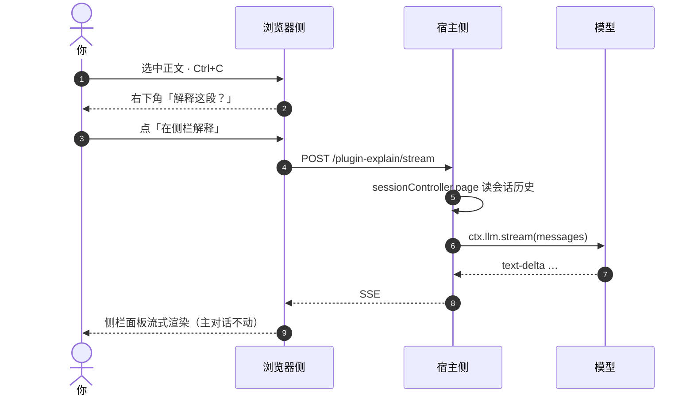

# dsh-plugin-side-explain

**[DeepSeek Harness](https://github.com/deepseek-ai/deepseek-harness) 的侧栏追问插件：选中一段，就地追问，答案不进入对话流。**

[](LICENSE)


> **English** — A DSH plugin that answers questions about any passage you select, in a side panel. The Q&A never touches the session log and the main transcript never scrolls. Zero runtime dependencies; the browser half renders its own Markdown.



## 为什么

长对话里遇到看不懂的一段，通常只有两条路：复制粘贴到输入框再发一条，或者放弃。前者会把问题插进主对话，越滚越长；而且长回答读完之后，想回到原来那一屏得手动滑回去。

这个插件把“提问”搬出对话流：

- **不写历史**：侧栏问答只是一次模型调用，会话日志一个字都不多。刷新、重启后它就不存在——这是特性，不是缺陷。
- **不动阅读位置**：回答在浮层里滚动，主对话的滚动位置、锚点、轮次轨道全都不受影响。
- **上下文仍是你的对话**：模型看得到当前会话的历史（与主输入框同源），所以“上面那个方案”“你刚说的第二点”能对上。

## 功能

| 能力 | 说明 |
| --- | --- |
| 选中即问 | 正文选中 ≥6 字 + `Ctrl+C`，右下角出现确认条；不打断你本来要复制粘贴的动作 |
| 加要求 | 「加要求」只开面板、光标进输入框，写完回车再发（例如“只讲第二点”“举个反例”） |
| 流式 Markdown | 标题、列表、粗体、行内代码、代码块、引用、链接，按聊天窗的排版渲染 |
| 同面板追问 | 回答完成后按钮变「追问」，带着前几轮问答继续；仍不写会话 |
| 可中断 | 生成中按钮变「停止」，只断这一次请求，面板保留 |
| 空正文诊断 | 模型没出正文时，报错里写明收到了哪些分片，便于定位 |
| 零依赖 | 不引第三方库，Markdown 渲染自带，宿主侧只用 `ctx.webServer` / `ctx.llm` |

## 安装

需要 DSH 自带 pnpm 的 `dsh plugin` 子命令，或用下面的手动方式。

**方式一：作为 bundle（推荐）**

```bash
dsh plugin --profile desktop add github:Echo-moli/dsh-plugin-side-explain
```

仓库里带了 `cordis.patch.yml`，`package.json` 也声明了 `dsh.bundle.patch`，安装时 patch 会自动应用。

**方式二：手动放置**

```powershell
$profile = "$env:USERPROFILE\.dsh\profiles\desktop"   # web 版换成 profiles\web
Copy-Item . "$profile\node_modules\dsh-plugin-side-explain" -Recurse -Force
```

然后在 `$profile\cordis.patch.yml` 末尾追加（先备份）：

```yaml
- insert:
    - id: ui-side-explain
      name: dsh-plugin-side-explain
```

**重启 DSH**。插件清单只在启动时读取。验证：`设置 → 插件 → 插件列表` 出现 `dsh-plugin-side-explain`，正文选中按 `Ctrl+C` 会浮出提示条。

## 使用

| 操作 | 结果 |
| --- | --- |
| 选中正文 ≥6 字 + `Ctrl+C` | 「解释这段？N 字 · 在侧栏解释 · 加要求」，6 秒内有效 |
| `在侧栏解释` | 打开面板，按默认提示解释 |
| `加要求` | 只开面板，光标入输入框，回车再发 |
| 回答完成后继续输入 | 追问；前几轮问答一并带上 |
| 生成中点 `停止` | 中断本次请求 |
| `Esc` / `关闭` | 收起面板，主对话位置不变 |

## 工作方式

同一个包，两处运行环境：

- **浏览器侧** `lib/client.js`（跑在页面里）：监听 `copy` / `Ctrl+C`，用 `[data-conversation-scroll]`、`[data-chat-turn]`、`[data-conversation-session]` 定位选区与轮次；自己画提示条、面板和 Markdown（**不复用**应用内部的 Markdown 组件——它会动态加载 shiki/katex，在真实模块加载器里拿不到资源会在渲染期抛错）。
- **宿主侧** `lib/index.js`（跑在 Node 进程里）：注册 `POST /plugin-explain/stream`，读会话历史 → 拼 messages → `ctx.llm.stream(...)` → 以 SSE 回推 `text-delta`。

整条链路只有一次模型调用，会话日志零写入。

## 上下文从哪来

| 来源 | 内容 | 上限 |
| --- | --- | --- |
| 会话日志（首选） | `sessionController.page` 读当前会话的 user/assistant 消息，与主对话同源 | 200 条消息 / 12000 字 |
| 界面节选（兜底） | 从选中那轮往前数 6 轮，末轮以选区为中心取窗口 | 6000 字 |
| 追问线程 | 同一面板里的问答对 | 6 轮 |

## 两条踩出来的硬约束

这两条都不是“优化”，是**不这么做就没有输出**：

1. **首条必须是 `user`**。历史按窗口截断后经常以 assistant 开头，提供方不报错、直接返回空（症状：`finish×1`，面板里一个字都没有）。代码会把开头不是 user 的消息丢掉。
2. **每一轮都要重新贴原文**。只贴一次的话，追问的最后一条 user 里没有原文，模型会回“没看到需要解释的文本”。

另外还有一条工程约束：宿主没有公开“当前会话游标”的接口，`page()` 必须传 `throughSeq`。这里的做法是先用一个越界值调用一次、从错误信息里取出真实游标，再读最后一页——不好看，但不需要碰私有方法。

## 兼容性与限制

- **依赖 DOM 约定**（`data-chat-turn`、`data-conversation-scroll`、`data-conversation-session`），DSH 升级后可能需要跟着改；失效表现是“复制没反应”。
- **端点无鉴权**：`/plugin-explain/stream` 只监听回环地址，但同机其他程序也能调用。
- 模型优先用当前会话的选择，读不到时交给提供方的默认值。
- 读回的是“尚未被压缩掉”的历史，与主输入框一致。
- 只支持文本选区；图片、附件、工具卡片不支持。

## 排错

| 现象 | 先看哪里 |
| --- | --- |
| 复制没反应 | `设置 → 插件 → 插件列表` 是否有加载失败；Console 搜 `selection-quote` |
| 面板打开但没有文字 | 报错里会写“收到 N 个分片（类型×数量）”；`finish×1` 通常意味着请求被判空 |
| 回答不带上下文 | 用自检入口确认历史有没有读到（见下） |
| 提示“没有可用的模型提供方” | 宿主侧 `ctx.llm.listProviders()` 为空，先在设置里配置模型 |

自检入口（只读，不调用模型）：

```bash
curl -s -X POST http://127.0.0.1:<port>/plugin-explain/stream \
  -H 'content-type: application/json' \
  -d '{"text":"probe","sessionId":"session-...","debug":true}'
```

## 开发

没有构建步骤：`lib/*.js` 就是产物。宿主侧用标准 ESM（`export function apply`）；浏览器侧由平台模块加载器投递，形式是 `window.__ModuleLoader__.load({ id, factory })` 的工厂，内部只有同步 `require`，因此不能写 `import`。一个包区分两处的办法是 `package.json`：`main` → 宿主侧，`exports["./client"]` → 浏览器侧，`dsh.client` 声明它要进浏览器名录。

改完把文件复制进 profile 的 `node_modules`，重启窗口验证（客户端 bundle 只在启动时快照）。

## 路线

- [ ] 侧栏历史（本地持久化，默认关）
- [ ] 「另存为笔记」：把一段问答写进工作区 Markdown
- [ ] 图片/附件选区
- [ ] 上游：把选区浮动条做成 `ui-chat` 的正式 slot

## License

[MIT](LICENSE)

